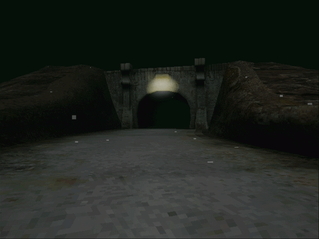

# Flax PSX
## A Flax Engine plugin that brings PSX-like visuals to your project

This plugin uses a custom post-processing effect that fully bypasses the engine’s internal scene rendering. Instead, it renders the scene directly into a GPU texture at the exact resolution you specify.
Because the scene is actually rendered at a low resolution — rather than rendered at full size and later pixelated — performance improves significantly. This approach is ideal for projects that rely on extremely low resolutions, delivering both visual accuracy and efficiency.

## Feature Status
The feature list may change from time to time.
- [x] PSX-Style post processing
  - [x] dithering
  - [x] integer scaling
  - [x] colour precision
- [x] Custom FX-chain by post processing materials
  - [x] depth-based fog
  - [ ] CRT effects (this is postponed)
- [x] Vertex Lighting
  - [x] Custom lighting actors
    - [ ] Caustics projection light (TR style)
  - [x] Custom lighting data
  - [x] lighting effects for fire (torches, etc.)
  - [x] lighting flicker variants, adapted from Q1
- [x] PSX-Style materials
  - [x] screenspace vertex snapping (the mind-boggle wobble)
  - [x] affine UVs (texture warping)
  - [x] distance-based affine UVs
  - [x] materials for vertex lighting system
  - [ ] materials for default lighting system
- [x] Caustics Volumes
  - [ ] PSX-style water caustics via volume (TR style)

## Notes:
* If you don't want to use the plugin's vertex lighting system, you can use the alternative materials which work with the engine's lighting system.
* You can just use the materials, without all post-processing.
* You can also only use the post-processing.
* This plugin has currently been tested with Windows 11 **only**.

> [!NOTE]  
> **REGARDING AI:** Yes. I use AI tools in software development. Yet, by far not all of my code is AI generated. *If* AI is used, *every bit* of generated code is reviewed and tested. I won't vibe-code large portions of code without reading it. Not now, not in the future.

---
## Breaking changes:
* **2026-10-XX**
  * Material names and parameters have been changed
  * A custom lighting system is now included
* **2026-04-08**
  * The code is now much more robust and maintainable
  * Extra script for post-processing resource managed has been removed
  * Features like additional post processing and CRT features directly in the main post-processing shaders have been removed
* ~~**2026.02.xx** new post-processing where fog and scanlines were removed. These will be replaced by post processing materials - this will offer more flexibility and a custom FX chain. A LEGACY VERSION IS INCLUDED BUT IS NO LONGER MAINTAINED!~~

---
## Installation
1. go to Tools → Plugins to open the Plugins window
2. click **Clone Project**
3. enter ``Flax PSX`` as *Plugin Name* and this repository as *Git Path*: `git@github.com:AcidicVoid/Flax-PSX.git`
4. create and empty actor in your project
    *  it's highly reccomended to disable all advanced graphics features like anti aliasing, camera artifacts, etc. if you're aiming for authentic retro visuals
5. Create an empty actor and add a **Flax PSX/PostProcessing** script to it
    * add the *FlaxPsxPostProcessing* shader to the Shader slot
    * play around with the settings
6. If you want to use the plugin's vertex lighting system, create an empty actor and add a `PsxVertexLightingSettings` script to it

---
## Installation Video

## Lighting System

| Name               | Description |
| ------------------ | ----------- |
| Directional | Light from one direction everywhere, like the sun or moon. It has no position or range. Only one is active per scene. |
| Point | Shines in all directions from one point and fades out at its Range. |
| Spot | A cone of light from one point, set by Angle. It fades with distance (Falloff) and towards the cone’s edge (Cone Falloff). |
| Area | A glowing rectangle, square or circle, set by Dimensions. It lights only what’s in front of it and fades with distance from the shape. *Experimental*. |

## Materials

### Vertex-Lit Materials
These materials make use of the plugin's own lighting system and ignore the engine's lights entirely.

| Name               | Description |
| ------------------ | ----------- |
| FPSX_VL_Surface    | Vertex-lit material for surfaces |
| FPSX_VL_DS_Surface | Vertex-lit material for surfaces, double sided |
| FPSX_VL_Liquid     | Vertex-lit material for liquid, intended for e.g. water surfaces |

### Default-Lit Materials
These materials are very basic and use the engine's lighting system.

| Name               | Description |
| ------------------ | ----------- |
| FPSX_Surface       | Lit material for surfaces |
| FPSX_DS_Surface    | Lit material for surfaces, double sided |
| FPSX_Liquid        | Lit material for liquid, intended for e.g. water surfaces |

### Unlit Materials
These materials are independant from the used lighting system

| Name               | Description |
| ------------------ | ----------- |
| FPSX_UL_LightRay   | Unlit material to use on meshes that act as light rays |

## Caustics Volume
*Coming Soon...*

## Physics

### Particles
When working with particle systems using SDF collision (e.g. snow or rain effects), it is required to add a `PsxParticleSystem` script to the `ParticleEffect` Actor and reference the `PsxPostProcessing` script.

## Support

#### Patreon
[Support me via Patreon](https://www.patreon.com/cw/AcidicVoid/membership)

#### Crypto
<table>
  <tr>
    <td>BTC (BIP84)</td>
    <td>bc1qu29uqhp2rg7845n4wy6fhax0fgp4eajadxp45z</td>
  </tr>
  <tr>
    <td>ETH</td>
    <td>0xCAE2f86E4658b3FC0E753A2143E5dCC09Edff694</td>
  </tr>
  <tr>
    <td>BONK</td>
    <td>25ePWvR1e8LxeJpz2E2LDB3gUjtCC1dtEg5umSWjAtTV</td>
  </tr>
</table>

## Sources

* PSX-Style dithering is designed according to Psy-Q documentation, page 424:  
https://psx.arthus.net/sdk/Psy-Q/DOCS/LIBREF46.PDF

* This repo was once forked from the example plugin project for Flax Engine. To learn more see the related documentation [here](https://docs.flaxengine.com/manual/scripting/plugins/index.html).
